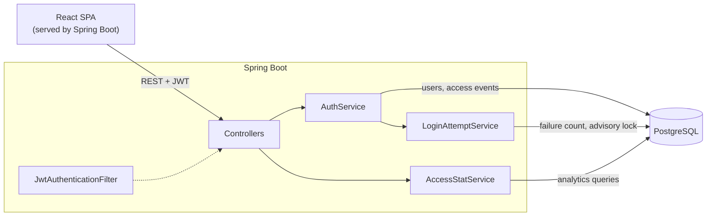

# AMC — Access Monitoring Console

Self-hosted service that records every authentication attempt, locks brute-force attacks and turns the audit trail into a live security dashboard.

**Spring Boot 3.4 · Java 21 · PostgreSQL 16 · React 19 · TypeScript · Tailwind CSS · Docker**

> Portfolio and learning project. Built with production practices in mind, but not intended for production use.

## Highlights

- **Live security dashboard** — login activity by hour or day, alert levels, response time, top failed accounts and a recent event log, refreshed every 30 seconds.
- **Brute-force lockout** — five failed logins lock an email for 15 minutes and return `429` with `Retry-After`.
- **Full audit trail** — every login and signup attempt is stored with status, IP address and latency.
- **Hardened authentication**
  - The same `401` for an unknown email, a wrong password and a disabled account, so accounts cannot be enumerated.
  - Equalized login timing: BCrypt runs even when the user does not exist.
  - Passwords are capped at 72 bytes, the BCrypt input limit, so nothing is silently truncated.
  - Per-account PostgreSQL advisory locks keep parallel requests from slipping past the lockout.
- **One-command deploy** — a multi-stage Docker build ships the React app inside the Spring Boot jar.

## Quick Start

Requires Docker with Docker Compose.

```bash
printf 'JWT_SECRET=%s\n' "$(openssl rand -base64 32)" > .env   # one-time signing key
docker compose up --build
```

Open http://localhost:8080, create an account and sign in. Your logins appear on the dashboard.

## Architecture



- **Stateless auth.** The client sends a signed JWT on every request, and `JwtAuthenticationFilter` re-checks the account status each time.
- **Events.** Every auth attempt is written to `access_events` with status `SUCCESS`, `FAILED`, `LOCKED` or `REGISTER_FAILED`.
- **Lockout.** `LoginAttemptService` counts recent `FAILED` events per email. `LOCKED` and `REGISTER_FAILED` events are not counted, so blocked attempts do not extend the lock and duplicate signups cannot lock someone else out.
- **One jar.** The React app is built into the jar, and `SpaController` forwards client routes to `index.html`.

## Tech Stack

| Layer    | Technology                                                                 |
|----------|----------------------------------------------------------------------------|
| Backend  | Java 21, Spring Boot 3.4, Spring Security, Spring Data JPA, Bean Validation |
| Auth     | Stateless JWT (jjwt 0.12), BCrypt                                           |
| Database | PostgreSQL 16                                                               |
| Frontend | React 19, TypeScript, Vite, Tailwind CSS v4, shadcn/ui, Recharts           |
| Data     | TanStack Query, react-hook-form, zod                                        |
| Testing  | JUnit 5, Mockito, MockMvc, Spring Security Test                             |
| Delivery | Maven (frontend-maven-plugin), Docker multi-stage build, Docker Compose     |

## Local Development

Requires JDK 21 and Docker. Node is optional, because Maven downloads its own.

```bash
docker compose up -d postgres          # PostgreSQL on localhost:5444
./mvnw spring-boot:run                 # API + built UI on http://localhost:8080
npm --prefix frontend run dev          # UI with hot reload on http://localhost:5173, proxies /api
```

- `./mvnw package` builds the React app into the jar. Add `-Dskip.installnodenpm -Dskip.npm` to skip the frontend build.
- `./mvnw test` runs the backend tests. Mockito does not support JDK 25 yet, so use JDK 21.

### Configuration

| Variable                      | Required | Default    | Description                                             |
|-------------------------------|----------|------------|---------------------------------------------------------|
| `JWT_SECRET`                  | yes      | —          | Base64-encoded HMAC key, at least 32 bytes when decoded |
| `JWT_EXPIRATION_MS`           | no       | `86400000` | Token lifetime in milliseconds (24 h)                   |
| `DB_PASSWORD`                 | no       | `root`     | PostgreSQL password                                     |
| `AUTH_LOCKOUT_MAX_ATTEMPTS`   | no       | `5`        | Failed logins per email that trigger a lockout          |
| `AUTH_LOCKOUT_WINDOW_MINUTES` | no       | `15`       | Lockout window in minutes                               |
| `APP_PORT`                    | no       | `8080`     | Host port for the Docker Compose app service            |

Locally, the variables are read from `.env` in the project root. The file is gitignored and loaded with `spring.config.import`. In production, set real environment variables instead. Without `JWT_SECRET` the application refuses to start.

## API

Every endpoint except `/api/auth/**` requires `Authorization: Bearer <token>`.

| Method | Path                             | Description                                  |
|--------|----------------------------------|----------------------------------------------|
| POST   | `/api/auth/register`             | Create an account                            |
| POST   | `/api/auth/login`                | Authenticate and receive a JWT               |
| POST   | `/api/auth/check`                | Verify that a token is valid                 |
| GET    | `/api/profile/me`                | Current user's profile                       |
| GET    | `/api/access/stat/hourly`        | Successful and failed logins over `range`    |
| GET    | `/api/access/stat/alert-lvls`    | Failure intensity levels over `range`        |
| GET    | `/api/access/stat/sla`           | Login success rate                           |
| GET    | `/api/access/stat/top-failed`    | Accounts with most failures, last 24 h       |
| GET    | `/api/access/stat/agent-status`  | Accounts by role and status                  |
| GET    | `/api/access/stat/health`        | Database health                              |
| GET    | `/api/access/stat/responce-time` | Login latency distribution by hour           |
| GET    | `/api/access/logs/recent`        | Last 10 access events                        |

`range` accepts `1h`, `24h` or `7d`.

**Validation:** username 3–20 characters (letters, digits, `_`, `.`, `-`), a valid email up to 254 characters, and a password of at least 8 characters and at most 72 bytes.

| Status | Meaning                                                          |
|--------|------------------------------------------------------------------|
| 400    | Validation failed; the body maps each field to a message         |
| 401    | Invalid credentials, inactive account, or a missing or bad token |
| 403    | Authenticated, but access is denied                              |
| 409    | Username or email already registered                             |
| 429    | Login locked; `Retry-After` gives the wait in seconds            |

## Testing

```bash
./mvnw test -Dskip.installnodenpm -Dskip.npm   # skip the frontend build for speed
```

44 tests cover:

- auth service logic: lockout, timing equalization, and an inactive account getting the same response as a wrong password;
- lockout window math with a fixed clock;
- DTO validation edge cases;
- the web layer with the real security chain and JWT filter (401, 404 and 429 paths, SPA routing).

## Project Structure

```text
src/main/java/com/dd01xc/service/
├── config/           Security chain, JWT filter
├── controller/       REST controllers, SPA route forwarding
├── model/            JPA entities and DTOs
├── repository/       Data access and analytics queries
└── service/          Auth, lockout, analytics
    └── exception/    Domain exceptions, global error handler
frontend/src/
├── components/       Layout and shadcn/ui components
├── features/         Dashboard widgets, landing preview
├── lib/              API client, session, validation schemas
└── pages/            Landing, login, signup, dashboard, profile
Dockerfile            Multi-stage build: frontend → jar → JRE runtime
docker-compose.yml    App + PostgreSQL with health checks
```

## Known Limitations

- No per-IP rate limiting on `/api/auth/**`. Signup reveals whether an email or username is taken.
- `access_events` has no retention policy and grows without bound.
- CORS is open to all origins, and `X-Forwarded-For` is trusted without a proxy allow-list.
- The schema is managed by `ddl-auto=update`, with no migrations.
- There is no role-based authorization beyond authenticated or anonymous.
- No integration tests against a real PostgreSQL, so native queries and advisory locks are covered only by unit tests with mocks.

## Roadmap

- [x] JWT authentication with hardened login flow
- [x] Per-account brute-force lockout
- [x] React dashboard and landing page
- [x] Single-jar build and Docker Compose deployment
- [ ] Per-IP rate limiting
- [ ] Testcontainers integration tests
- [ ] Flyway migrations
- [ ] Admin role: disable accounts, browse full logs
- [ ] Production profile (restricted CORS, trusted proxies)
- [ ] CI pipeline

## License

Educational and portfolio use only. No license is granted for redistribution.
