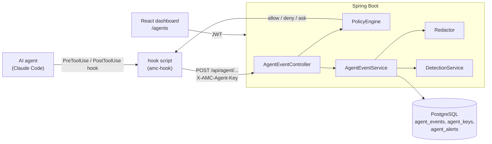

# Agent Access Monitoring — design brief

> For Claude Code: this is the product direction for the next phase of AMC. Read it together with `CLAUDE.md`.
> All rules in `CLAUDE.md` still apply (learning project: explain each change before editing, branch per topic, conventional commits, English comments).
> Work **one phase at a time**. Before each phase: propose a short plan, wait for approval, then implement with tests.

## 1. The idea

AMC today monitors **humans** logging in: every auth attempt becomes an `access_event`, brute force gets locked, the dashboard shows the audit trail.

Next step: monitor **AI coding agents** in the same way.

Agents like Claude Code, Copilot agent mode or Cursor read files, run shell commands, call MCP tools and make network requests on a developer's machine or in CI. Nobody audits that. AMC becomes the **audit and policy layer for AI agents**:

1. **See** — every tool call an agent makes is recorded (who, which session, which tool, what input, result, time).
2. **Control** — before a risky action runs, AMC decides `allow` / `deny` / `ask` from policy rules.
3. **Detect** — suspicious patterns are flagged (secret access, exfiltration, prompt-injection-like behaviour).
4. **Explain** — the dashboard (and later an optional LLM summary) shows what each agent session did.

One-line pitch: *"AMC records and controls what AI agents do on your machine, the same way it already does for human logins."*

### Why (career context)
Portfolio project aimed at DevSecOps / Platform Engineer roles in Oslo. Job ads ask for: cloud (Azure), Terraform, CI/CD, Python/Java, and "security, authentication and access control in cloud environments". The project should show exactly that, plus current AI-agent security (OWASP Top 10 for LLM Applications / Agentic AI, "excessive agency").

## 2. How it fits the existing code

- Reuse the existing patterns: event table → analytics service → masked DTOs → dashboard.
- **Separate table** `agent_events`. Do NOT reuse `access_events`: lockout logic counts rows there.
- Same rule as today: the DB may hold raw values, **API responses are masked/redacted**. Never return entities.
- New package area: `com.dd01xc.service.agent` (controller, service, policy, detection, model, repository).
- Human users (JWT) see the dashboard. **Agents authenticate with API keys**, not JWT.
- **Owner scoping from day one.** Agent data (file paths, commands) is more sensitive than login analytics, and signup is open. Every `/api/agent/**` dashboard query filters by the key's `owner_user_id`; no cross-user reads until an ADMIN role exists.

## 3. Architecture

### Integration point: Claude Code hooks
Claude Code can run a command on `PreToolUse` and `PostToolUse`. The hook gets JSON on stdin (`session_id`, `cwd`, `hook_event_name`, `tool_name`, `tool_input`, and on PostToolUse also `tool_response`).

- `PreToolUse` → hook calls `POST /api/agent/decide` → AMC answers allow/deny/ask → hook prints the matching Claude Code decision JSON (or exits with code 2 to block).
- `PostToolUse` → hook calls `POST /api/agent/events` (fire-and-forget, short timeout).
- Hook script lives in `tools/amc-hook/` (small, no heavy dependencies; bash + curl or a tiny Python script). Include an example `.claude/settings.json` snippet in the README.
- Verify the exact hook input/output format against the current Claude Code docs before implementing; do not guess.

Later (optional): an MCP proxy so non-Claude agents can be monitored too. Design the API so the source is a field (`agent_type`), not hard-coded.

## 4. Data model (first draft — refine in phase 1)

`agent_keys`: id, name, key_hash (store only a hash, show the key once), owner_user_id, created_at, revoked_at.

`agent_events`: id, agent_key_id, session_id, agent_type, event_type (`PRE_TOOL`, `POST_TOOL`), tool_name, target (redacted summary: file path, command head, domain), decision (`ALLOW`/`DENY`/`ASK`/null), rule_id, risk_level, duration_ms, created_at (`timestamptz`).

`agent_alerts`: id, session_id, detection_id, severity, description, event_ids, created_at, acknowledged_at.

**Redaction is mandatory before storing.** `tool_input`/`tool_response` can contain secrets and source code. Store a redacted summary + HMAC (server-side key, not plain SHA-256: low-entropy secrets are brute-forceable from a bare hash), never the full payload. Add a retention setting (like the planned `access_events` retention).

## 5. Phases

### Phase 0 — CI, migrations and supply-chain basics (already on the todo list)
- Flyway: baseline the current schema, replace `ddl-auto=update` with `validate`, drop `init/TimestampMigration`. New agent tables must arrive as migrations, not Hibernate DDL.
- Testcontainers (Postgres 16) for repository/integration tests: native SQL and advisory locks are Postgres-only, H2 cannot run them.
- GitHub Actions: build + tests (JDK 21), frontend build.
- Security scanning: CodeQL or Semgrep (SAST), Dependabot, Trivy on the Docker image, gitleaks for secrets.
- Generate an SBOM (CycloneDX Maven plugin) as a build artifact.
- Done when: every PR runs all checks; README has badges.

### Phase 1 — See: event ingestion
Three PRs: (a) `agent_keys` + auth filter, (b) ingestion + `Redactor` + hook, (c) `/agents` dashboard.
- `agent_keys` + API key auth filter for `/api/agent/**` (separate from the JWT chain in `SecurityConfig`).
- `POST /api/agent/events`, `AgentEvent` entity, `Redactor`, validation, rate limit per key.
- `tools/amc-hook` for PostToolUse + README setup.
- Dashboard page `/agents`: sessions list, timeline per session, top tools, events per hour (reuse chart components).
- Tests: controller (`@WebMvcTest` pattern from `ProtectedEndpointsTest`), redactor unit tests with real-looking secrets.

### Phase 2 — Control: policy engine
- Rules in YAML (`src/main/resources/agent-policy.yml`, overridable via config). Each rule: id, description, match (tool name, path glob, command regex, domain), action (`deny`/`ask`/`allow`), severity.
- Starter rules: deny reading `.env`, `**/*.pem`, `~/.ssh/**`, `~/.aws/**`; ask on `rm -rf`, `git push --force`, `curl|wget` to non-allowlisted domains; deny `curl ... | sh`.
- `POST /api/agent/decide` → returns decision + rule_id + reason; every decision is logged.
- Decide and document: **fail-open or fail-closed** when AMC is unreachable (make it configurable, default documented in "Decisions").
- **Latency budget:** PreToolUse is synchronous on every tool call. Rules are held in memory (no DB on the hot path), the decision event is written async, and the hook has a hard timeout (~1-2 s) that falls back to the fail-open/closed setting.
- Keep it a plain Java rule engine first. OPA/Rego is an optional later upgrade (mention as a design choice).
- Tests: table-driven tests for every starter rule, including bypass attempts (path tricks like `./.env`, `../`, quoting, `bash -c`).

### Phase 3 — Detect: session-level detections
- Secret patterns in tool input/output (AWS keys, GitHub tokens, private keys, JWTs) → alert, never store the secret.
- Sequence detections per session: sensitive read followed by network call (possible exfiltration); many denied actions in a row; agent reading a file then immediately trying an unrelated risky command (prompt-injection-like).
- Map every detection to OWASP Top 10 for LLM / Agentic AI in a table in the README.
- Dashboard: alerts panel, severity badges (reuse `StatusBadge`).

### Phase 4 — Explain: optional LLM session summary
- Behind a feature flag, off by default. Input is the already-redacted event list only.
- Output: short human summary of a session + suggested severity.
- **The LLM never makes allow/deny decisions.** Deterministic rules decide; the LLM only explains. Document why (prompt injection, non-determinism).

### Phase 5 — Cloud: Terraform + Azure
- `infra/` with Terraform: Azure Container Apps, PostgreSQL Flexible Server, Key Vault, Managed Identity, Log Analytics.
- GitHub Actions deploys via OIDC federation (no cloud secrets in GitHub).
- Sign images with cosign; scan Terraform with Checkov or tfsec in CI.

### Phase 6 — Demo and documentation
- Scripted demo: an agent session tries to read `.env` and send it with curl → AMC blocks it and raises an alert. Record a 2-minute video/GIF.
- `docs/threat-model.md` (STRIDE for AMC itself: spoofed agent keys, tampered events, DoS on ingestion, hook bypass).
- README: updated pitch, architecture diagram, screenshots, limitations (hooks are client-side and can be bypassed by a malicious user; AMC targets mistakes and injected instructions, not a hostile machine owner).

## 6. Rules for this work
- One phase = one or more branches (`feat/agent-ingestion`, `feat/agent-policy`, ...), small PRs.
- Explain the plan and the "why" before editing (learning project).
- Security over features: redaction, masking, key hashing and tests come first.
- Add new decisions to the "Decisions" section of `CLAUDE.md` when they are made.
- Ask before adding a new major dependency.

## 7. Open questions (decide together, then record in CLAUDE.md)
Each has a proposed default; not decided yet.
- Fail-open vs fail-closed default. *Proposed:* fail-open by default (dev tool, AMC targets mistakes, not a hostile owner), fail-closed configurable for CI.
- One AMC instance per developer, or multi-tenant per team? *Proposed:* single instance, owner-scoped data (section 2), so multi-tenant is cheap later.
- Store any raw payloads at all (encrypted, short retention), or redacted summaries only? *Proposed:* redacted summaries only.
- Product name for this module (e.g. "AMC Agents"). *Proposed:* "AMC Agents".
